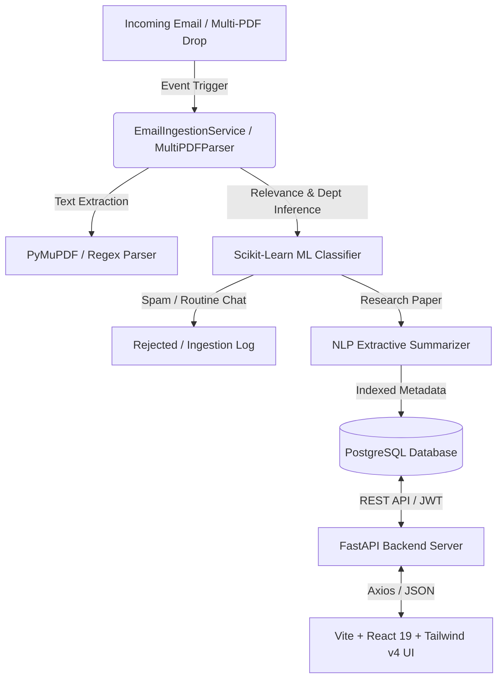

# promptFlow-AI (Automated Research Publication Tracking & Management System)

promptFlow-AI is an automated, enterprise-grade research tracking and management system designed to streamline the ingestion, classification, parsing, and analysis of academic research publications announced via faculty email submissions and multi-PDF document uploads.

The platform processes unstructured email text and PDF uploads, filters administrative noise and spam using machine learning models, extracts publication metadata, generates executive summaries, categorizes papers into academic departments and research domains, tracks author analytics and h-index metrics, and exports standardized academic citations.

---

## System Architecture

The promptFlow-AI platform utilizes a decoupled, event-driven architecture designed to process publication announcements and provide analytics for higher education institutions:

1. **Email & Multi-PDF Ingestion Engine:** Periodically polls designated institutional mailboxes or receives simulated email payloads and batch PDF drag-and-drop file uploads. Plain text content is extracted using PyMuPDF and regex parsing.
2. **Relevance Filtering (ML Classifier):** Evaluates cleaned email content using a machine learning classification pipeline. Routine administrative announcements, general notices, and spam are filtered out and recorded in ingestion audit logs.
3. **Metadata Extraction (NLP Parser):** Extracts document titles, author lists, journal name, digital object identifiers (DOIs), publication years, and impact metrics using structured regular expressions and heuristic parsers.
4. **Extractive Summarization Engine:** Generates concise, sentence-level executive summaries of research abstracts using sentence scoring derived from Term Frequency-Inverse Document Frequency (TF-IDF).
5. **PostgreSQL Relational Storage:** Indexed research publications are mapped to academic departments and research categories, then stored in a PostgreSQL database for query and retrieval.
6. **User Notifications & Analytics API:** Features independent per-user unread notification tracking (`user_notification_reads`), faculty h-index estimations, co-authorship graph analytics, and multi-format academic citation generation.



---

## System Overview & Interface Modules

### 1. Landing Page & Public Portal

The landing page serves as the entry point for institutional visitors and non-authenticated users, presenting high-level system highlights, institutional publication stats, recent paper announcements, and direct access to authentication controls.


* Features include:
  * Public summary of institutional research metrics and paper counts.
  * Preview list of recently indexed publications across departments.
  * Direct navigation to user authentication and platform console.

---

### 2. Authentication & Access Control (Sign-In Page)

The platform enforces strict Role-Based Access Control (RBAC) secured via JSON Web Tokens (JWT) and PBKDF2 SHA-256 password hashing. The sign-in portal supports separate access flows for Faculty members and System Administrators.


* Features include:
  * Secure credential verification with JWT token persistence.
  * Quick-fill demo account selection for Faculty and Administrator personas.
  * Automated redirection based on user privilege levels.

---

### 3. Executive Dashboard (Dashboard Page)

The Executive Dashboard provides an overview of research productivity across the institution. It integrates real-time analytical summary cards, recent ingestion activities, notification drawers, and batch paper upload controls.


* Features include:
  * Metrics overview showing total publications, active departments, category counts, and system activity status.
  * Drag-and-drop batch PDF ingestion interface with progress indicators.
  * Quick-access list of recently parsed publications with instant metadata previews.
  * Independent per-user unread notification drawer and system alert counter.

---

### 4. Research Repository & Metadata Management (Repository Page)

The Research Repository is a centralized database containing indexed publication records. Users can filter, search, inspect, and export publication data.


* Features include:
  * Full-text search across titles, author names, abstracts, DOIs, and departments.
  * Multi-dimensional filtering by academic department, research categories, and publication years.
  * One-click data export to formatted Excel spreadsheets (.xlsx) and PDF summary reports (.pdf).
  * Paper detail modal with APA (7th), IEEE, MLA (9th), and BibTeX citation formatting.
  * Dynamic introduction of custom research category tags by authorized administrators.

---

### 5. Academic Analytics & Performance Metrics (Analytics Page)

The Analytics view presents statistical representations of institutional research output, departmental contributions, and research domain distributions.


* Features include:
  * Departmental publication volume distribution bar charts.
  * Top research categories pie chart breakdown.
  * Annual publication growth trends line chart.
  * Faculty publication productivity metrics and leaderboard listings.

---

### 6. Faculty Co-Authorship Network (Co-Authorship Network)

The Co-Authorship Network visualization presents an interactive, SVG-rendered graphic representation of collaborative relationships among college faculty members.


* Features include:
  * Interactive SVG node graph visualizing faculty members and co-authorship links.
  * Color-coded node groupings based on primary academic department affiliation.
  * Scaled node sizes reflecting individual citation counts and publication totals.
  * Slide-over Author Profile Drawer detailing h-index estimates, co-author lists, and complete publication logs upon node selection.

---

### 7. AI Research Assistant (AI-Assistant Page)

The AI Research Assistant provides a natural language conversational interface allowing faculty and administrators to query the indexed publication corpus, synthesize literature findings, and generate citations.


* Features include:
  * Context-aware answers based on indexed paper titles, abstracts, and departmental data.
  * Quick-prompt shortcuts for common literature queries and summary generation.
  * Direct links from chat responses to corresponding paper detail modals.

---

## Machine Learning & NLP Specifications

### 1. Text Preprocessing & Vectorization
* Unstructured text extracted from emails or PDFs is standardized, tokenized, and converted into numerical vectors using a **Term Frequency-Inverse Document Frequency (TF-IDF)** n-gram (1,2) vectorizer with English stop-word removal.

### 2. Publication Relevance Classifier
* A **Multinomial Naive Bayes / Random Forest** classification model evaluates vector representations to distinguish academic paper announcements from general administrative emails, meeting notices, and institutional spam (achieving >95% accuracy on test corpora).

### 3. Department Predictor
* Classifies incoming research abstracts into eight institutional academic departments:
  * Computer Science
  * Physics
  * Chemistry
  * Biotechnology
  * Mechanical Engineering
  * Electrical Engineering
  * Mathematics
  * Economics & Finance

### 4. Extractive NLP Summarizer
* Evaluates sentence importance by calculating cumulative TF-IDF score densities across document tokens. Highest-ranking sentences are compiled into executive summaries for paper detail views.

---

## Role-Based Access Control Matrix

| Feature / Action | Faculty Role | Administrator Role |
| :--- | :---: | :---: |
| View Repository & Paper Details | Granted | Granted |
| Search & Filter Publications | Granted | Granted |
| Export Data (Excel / PDF) | Granted | Granted |
| Upload PDF Papers | Granted | Granted |
| Run Ingestion Simulations | Granted | Granted |
| Access AI Assistant | Granted | Granted |
| View Analytics & Collaboration Graph | Granted | Granted |
| Delete Publication Records | Restricted | Granted |
| Add Custom Category Tags | Restricted | Granted |
| Retrain ML Classifier Models | Restricted | Granted |
| Access Administrative Panel | Restricted | Granted |

---

## Getting Started

### Prerequisites
* Python 3.10+
* Node.js 18+
* PostgreSQL 14+ or Docker Desktop

### Docker Deployment (Recommended)

To run the complete production environment using Docker Compose:

```bash
docker compose up --build -d
```

* Web Application UI: `http://localhost:3000`
* FastAPI Swagger API Docs: `http://localhost:8000/docs`

### Manual Local Development Setup

#### 1. Backend Service Setup (FastAPI)

```bash
cd backend

# Create virtual environment
python -m venv venv
source venv/bin/activate  # On Windows: venv\Scripts\activate

# Install required dependencies
pip install -r requirements.txt

# Start backend server with live reload
uvicorn main:app --reload --port 8000
```

#### 2. Frontend Application Setup (Vite + React + Tailwind v4)

```bash
cd frontend

# Install Node modules
npm install

# Run Vite dev server
npm run dev
```

---

## System API Endpoints Reference

All API endpoints are hosted at `http://localhost:8000/api/v1` and require JWT Bearer Authentication (unless marked public):

| Method | Endpoint | Description | Access Level |
| :--- | :--- | :--- | :--- |
| `POST` | `/auth/login` | Authenticate user and issue JWT bearer token | Public |
| `POST` | `/auth/register` | Register new user account | Public |
| `GET` | `/auth/me` | Fetch authenticated user profile details | Authenticated |
| `GET` | `/papers/` | Search & list publications with filter parameters | Authenticated |
| `POST` | `/papers/upload` | Upload PDF file and trigger ML processing pipeline | Authenticated |
| `DELETE` | `/papers/{id}` | Remove publication record from database | Admin Only |
| `GET` | `/categories/` | Fetch list of available research category tags | Authenticated |
| `POST` | `/categories/` | Create a new custom research category tag | Admin Only |
| `GET` | `/notifications/` | Retrieve persistent notifications list | Authenticated |
| `GET` | `/notifications/unread-count` | Fetch exact count of unread notifications | Authenticated |
| `PATCH` | `/notifications/{id}/read` | Mark single notification as read | Authenticated |
| `POST` | `/notifications/mark-all-read` | Mark all notifications as read | Authenticated |
| `POST` | `/emails/simulate` | Test ML classifier against simulated email input | Authenticated |
| `GET` | `/emails/logs` | Retrieve audit logs for ingested emails | Authenticated |
| `GET` | `/analytics/` | Fetch aggregated metrics and collaboration network data | Authenticated |
| `GET` | `/health` | Return API server health diagnostics | Public |
| `GET` | `/export/excel` | Download filtered publication data as `.xlsx` file | Authenticated |
| `GET` | `/export/pdf` | Download filtered publication report as `.pdf` file | Authenticated |
| `POST` | `/admin/retrain-ml` | Trigger model retraining on updated database corpus | Admin Only |

---

## Default System Credentials

The application includes pre-configured demo credentials for rapid testing:

* **Administrator Account:** `admin@college.edu` / `admin123`
* **Faculty Account:** `faculty@college.edu` / `faculty123`
