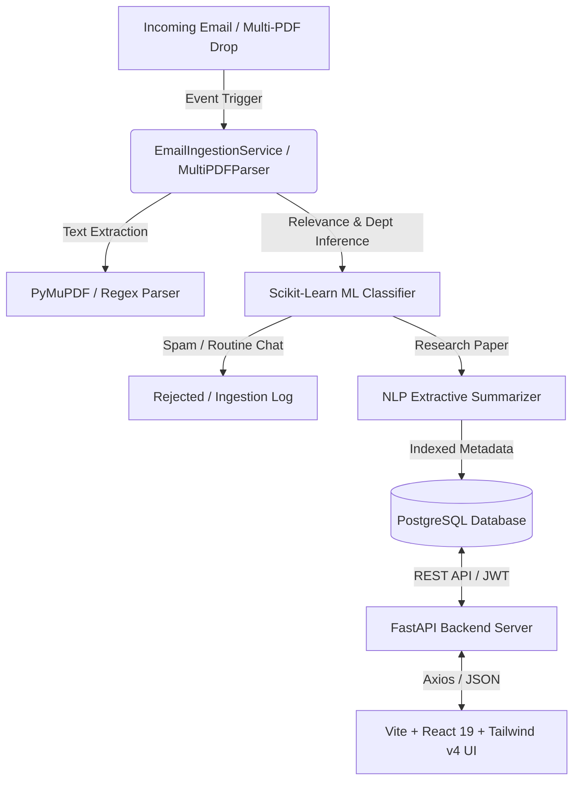

# promptFlow-AI System (Research Publication Tracking & Management)

promptFlow-AI is an automated, enterprise-grade research tracking and management system designed to streamline the ingestion, classification, parsing, and analysis of academic research publications announced via faculty emails and multi-PDF uploads.

The system automates the processing of email communications, filters administrative noise and spam, extracts paper metadata, generates executive summaries, classifies publications by academic department and research category, tracks author analytics and h-index metrics, and generates academic citations.

---

## Core System Architecture

The promptFlow-AI System uses a decoupled, event-driven architecture that automatically processes incoming publication announcements:

1. **Email & Multi-PDF Ingestion:** The system periodically polls the target mailbox or accepts simulated email payloads and batch PDF drag-and-drop uploads. Clean, plain text content is extracted using PyMuPDF and regex parsing.
2. **Relevance Filtering (ML Classifier):** Cleaned email text is evaluated by a machine learning classification pipeline. Emails determined to be administrative chatter or spam are logged and rejected from database indexing.
3. **Metadata Extraction (NLP Parser):** Document headers, multi-line author lists, journal titles, DOIs, publication years, and impact metrics are extracted using structured regex and pattern heuristic parsers.
4. **Extractive Summarization (NLP Engine):** The text is summarized into a concise, sentence-level executive summary using TF-IDF sentence scoring.
5. **PostgreSQL Database Storage:** Indexed research papers are associated with academic departments and relevant research categories, then stored in the PostgreSQL database for query and retrieval.
6. **Per-User Notifications & Analytics:** Features independent per-user unread notification tracking (`user_notification_reads`), faculty h-index calculations, and multi-format academic citation generation.



---

## Key System Features

* **PostgreSQL Standardization:** Enterprise database standardization for 100% development-to-production parity.
* **Persistent User Notifications API:** Independent per-user read/unread state tracking for system-wide and target notifications via `UserNotificationRead` and direct database count endpoints (`GET /api/v1/notifications/unread-count`).
* **Interactive Platform Guide & Diagnostics:** Real-time health check diagnostics modal with system architecture diagrams, keyboard shortcuts, and role privilege reference cards.
* **BibTeX & APA Citation Exporter:** One-click citation exporter supporting APA (7th Edition), IEEE, MLA (9th Edition), and BibTeX format generation.
* **Faculty Author Profiles & H-Index Drawer:** Slide-over drawer providing estimated faculty h-index calculations, citation counts, top journals, frequent co-authors, and full publication history.
* **Multi-PDF Drag & Drop Ingestion:** Drag-and-drop batch PDF paper ingestion with live progress bars and automatic category tagging.

---

## Machine Learning and NLP Pipelines

### Relevance and Department Classification
The system uses a Scikit-Learn machine learning pipeline initialized and trained at startup:
* **Feature Extraction:** Standardized text is vectorized using a Term Frequency-Inverse Document Frequency (TF-IDF) n-gram (1,2) Vectorizer with English stop-word filtering.
* **Relevance Classifier:** A Multinomial Naive Bayes model determines whether the incoming email text represents a research publication announcement or administrative spam.
* **Department Classifier:** Categorizes research publications into eight college academic departments (Computer Science, Physics, Chemistry, Biotechnology, Mechanical Engineering, Electrical Engineering, Mathematics, Economics & Finance).

### Extractive NLP Summarizer
Generates a concise executive summary by tokenizing the input text into sentences, computing sentence-level TF-IDF importance scores based on document terms, and selecting the highest-scoring sentences.

---

## Getting Started

### Prerequisites
* Python 3.10 or higher
* Node.js 18 or higher
* PostgreSQL server or Docker Compose (recommended)

### Docker Deployment
Build and run the entire stack (FastAPI Backend, PostgreSQL Database, Nginx serving compiled React frontend):
```bash
docker compose up --build -d
```
* Interactive Web Application: http://localhost:3000
* API Swagger Documentation: http://localhost:8000/docs

### Manual Development Setup

#### Backend Setup
1. Navigate to the backend directory:
   ```bash
   cd backend
   ```
2. Create and activate a Python virtual environment:
   ```bash
   python -m venv venv
   source venv/bin/activate
   ```
3. Install dependencies:
   ```bash
   pip install -r requirements.txt
   ```
4. Run the development server:
   ```bash
   uvicorn main:app --reload --port 8000
   ```

#### Frontend Setup
1. Navigate to the frontend directory:
   ```bash
   cd frontend
   ```
2. Install Node dependencies:
   ```bash
   npm install
   ```
3. Compile and start the development server:
   ```bash
   npm run dev
   ```

---

## API Endpoints Summary

All API endpoints are prefixed with `/api/v1` and require JWT bearer authorization (except public endpoints):

* `POST /auth/login` - Obtain authorization token.
* `POST /auth/register` - Create a new user account.
* `GET /auth/me` - Return current authenticated user profile.
* `GET /papers/` - Query publication repository with filters (title, author, department, category, year).
* `POST /papers/upload` - Upload PDF and trigger metadata extraction pipeline.
* `DELETE /papers/{id}` - Delete a paper (Admin only).
* `GET /notifications` - Retrieve persistent notifications with per-user read state.
* `GET /notifications/unread-count` - Get exact unread notifications count directly from DB.
* `PATCH /notifications/{id}/read` - Mark single notification as read for current user.
* `POST /notifications/mark-all-read` - Mark all unread notifications as read for current user.
* `POST /emails/simulate` - Simulate email arrival and execute ML classification pipeline.
* `GET /emails/logs` - Retrieve historical ingestion audit logs.
* `GET /health` - Return real-time system health and service status.
* `POST /admin/retrain-ml` - Force retraining of classification models on current corpus (Admin only).

---

## Default System Credentials

For testing and local development, the system is seeded with the following demo credentials:

* **Administrator Account:** `admin@college.edu` / `admin123`
* **Faculty Account:** `faculty@college.edu` / `faculty123`
