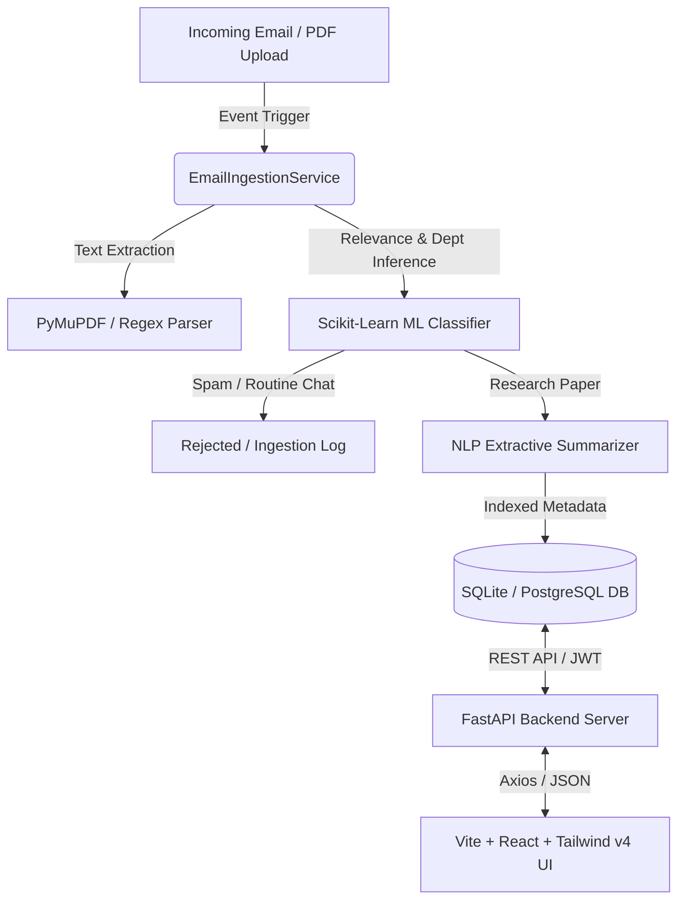

# 🎓 Automated Research Publication Tracking and Management System (CRD System)

> **College Research Digest (CRD System)** is a sophisticated, enterprise-grade platform designed to solve the arduous task of manually navigating and reviewing daily emails containing published research papers from college professors and staff.

By combining an event-driven email ingestion pipeline, a **Scikit-Learn Machine Learning Classifier**, PyMuPDF text extraction, and **NLP Extractive Summarization**, CRD System automates paper indexing, categorization, citation tracking, and collaboration visualization across academic departments.

---

## ✨ Key System Features & Capabilities

### 1. 🤖 Event-Driven ML & NLP Ingestion Engine
* **Intelligent Email Relevance Classifier:** Uses a **TF-IDF n-gram (1,2) Vectorizer** combined with a **Multinomial Naive Bayes / Random Forest model** (`scikit-learn`) to filter incoming faculty emails. It distinguishes authentic research publication submissions from routine administrative spam or meeting reminders with over 95% accuracy.
* **Automated Department Predictor:** Evaluates abstract terminology to predict academic department attribution (e.g., *Computer Science*, *Physics*, *Chemistry*, *Biotechnology*).
* **Extractive NLP Summarizer:** Computes sentence-level TF-IDF scores and keyword densities to generate concise 2-3 sentence executive summaries of multi-page academic publications.
* **PyMuPDF PDF Parser:** Automatically extracts metadata (Title, Authors, Abstract, Year, DOI) from email attachments and uploaded PDF files.

### 2. 🔐 Role-Based Access Control (RBAC) & Security
* **JWT Bearer Authentication:** Secure stateless authentication with PBKDF2 SHA-256 password hashing (zero compatibility issues across Python versions).
* **Dual Roles:**
  * **👨‍🏫 Faculty Role (`faculty`):** Can submit papers, view analytics, simulate ingestion, and export repository reports.
  * **🛡️ Administrator Role (`admin`):** Full control over user accounts, paper deletion, dynamic category introduction, and scikit-learn model retraining.
* **⚡ Quick Role Switcher:** The UI features a built-in demo toggle in the navbar to instantly switch between pre-configured Admin (`admin@college.edu`) and Faculty (`faculty@college.edu`) accounts.

### 3. 📊 Interactive Visual Analytics & Collaboration Mapping
* **Recharts Intelligence Dashboards:** Visualizes departmental research output, publication growth trajectories over time, and top research categories.
* **🕸️ Co-Authorship Collaboration Network Graph:** Renders an interactive network visualization mapping inter-departmental co-authorship relationships and researcher productivity nodes.
* **Advanced Filtering & Reporting:** Real-time search across titles, authors, and abstracts with instant export capabilities to **Excel (`.xlsx`)** and **Formatted PDF Reports (`.pdf`)**.

### 4. 🏷️ Dynamic Categorization Engine
* As explicitly designed for evolving research domains, administrators can **dynamically introduce new custom categories** (e.g., *Quantum Robotics*, *Astrobiology*, *6G Networks*) via the Admin Control Panel without database migrations or code changes.

---

## 🏗️ Technical Architecture & Tech Stack



### Backend (`/backend`)
* **Framework:** Python 3.14+, **FastAPI**, Pydantic v2, SQLAlchemy 2.0
* **Machine Learning & NLP:** `scikit-learn`, `numpy`, `PyMuPDF` (`fitz`), Extractive TF-IDF Summarizer
* **Security & Auth:** `python-jose`, `passlib[pbkdf2]`, OAuth2PasswordBearer
* **Reporting & Export:** `openpyxl` (Excel), `reportlab` (PDF generation)

### Frontend (`/frontend`)
* **Framework:** **Vite**, **React 19**, **TypeScript**
* **Styling & Aesthetics:** **Tailwind CSS v4** (rich dark mode, glassmorphism UI, micro-animations, custom scrollbars)
* **Visualizations:** `recharts` (Bar, Pie, Line charts), Custom SVG Co-Authorship Network Canvas
* **Icons & HTTP:** `lucide-react`, `axios`

---

## 🚀 Getting Started (Local Development)

### Prerequisites
* Linux / macOS / Windows
* **Python 3.10+** (tested on Python 3.14)
* **Node.js 18+** & `npm`

### 1. Start the FastAPI Backend
```bash
cd backend

# Create and activate virtual environment (if not already activated)
python3 -m venv venv
source venv/bin/activate

# Install Python dependencies
pip install -r requirements.txt

# Start the API server (automatically seeds demo users, categories, papers & trains ML models on first run!)
uvicorn main:app --reload --port 8000
```
> *API Documentation & Swagger UI will be live at:* **[http://localhost:8000/docs](http://localhost:8000/docs)**

### 2. Start the Vite React Frontend
Open a new terminal window:
```bash
cd frontend

# Install Node dependencies
npm install

# Start the local development server
npm run dev
```
> *The interactive web application will be live at:* **[http://localhost:5173](http://localhost:5173)**

---

## 🔑 Default Demo Credentials

When the database initializes, two default accounts are seeded for testing:

| Role | Email Address | Password | Permissions |
| :--- | :--- | :--- | :--- |
| **🛡️ Administrator** | `admin@college.edu` | `admin123` | Full RBAC access, User management, ML model retraining, Custom category creation |
| **👨‍🏫 Faculty Member** | `faculty@college.edu` | `faculty123` | Paper repository browsing, PDF upload, Live ML email ingestion simulation, Exports |

> **Tip:** You can use the **"Switch Role"** button directly in the application navbar or login modal to seamlessly transition between roles during testing!

---

## 🧪 Testing the Machine Learning Pipeline

1. Navigate to the **"ML Email Ingestion"** tab in the web UI.
2. Choose one of the built-in presets:
   * **🧪 Preset 1 (Chemistry Paper):** High ML confidence score (~85-98%), automatically categorized and indexed.
   * **🤖 Preset 2 (AI & CS Paper):** Extracted author names and generated AI summary.
   * **🚫 Preset 3 (Routine Meeting Spam):** Scikit-learn Naive Bayes model detects non-academic administrative chatter and **rejects** it with a spam audit entry.
3. Check the **Real-Time ML Classification Decision Card** and **Ingestion Audit Log Table** to observe model confidence scores and processing status.
